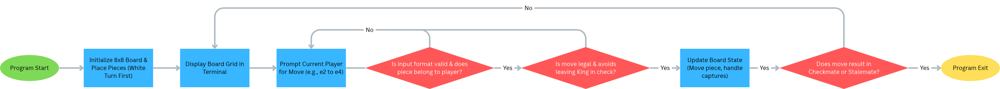

# Terminal-Based Chess Playing Program

A two-player terminal chess game built in Java to provide a lightweight, local strategy game experience that runs directly in a command-line environment.

## The Problem

As a computer science student, I enjoy playing strategy games like chess with friends between classes, but many online platforms require accounts, heavy web browsers, or constant internet connections.

I wanted to build a lightweight, local terminal-based chess game that runs instantly in any command-line environment. This project also helps me deepen my understanding of object-oriented inheritance, complex move validation, and 2D board state management in Java.

## How It Works

This application is a command-line interface (CLI) program that enables two players to play chess directly within the terminal.

The application maintains an 8x8 grid board, alternates turns between White and Black, parses player coordinate inputs, validates piece movement rules, and checks whether moves leave a player's king in check. It also handles pawn promotion and detects game-ending checkmate or stalemate conditions.



## Features

- Two-player chess gameplay in the terminal
- 8x8 board representation using a 2D array
- Coordinate-based move input (e.g., `e2 e4`)
- Piece movement validation
- Check detection
- Checkmate and stalemate detection
- Pawn promotion

**Not implemented:** Castling and en passant.

## Tech Stack

- **Language:** Java (JDK 17+)
- **Libraries:** Java standard library, including `java.util.Scanner` and `java.util.Arrays`
- **External tools:** Standard terminal / command prompt

## Setup

Clone the repository and navigate to the project directory:

```bash
git clone https://github.com/Arkapravo-Sen/Arkapravo-Sen-CS-193-Week-9.git
cd Arkapravo-Sen-CS-193-Week-9
```

Compile the Java source files:

```bash
javac src/*.java
```
Navigate into /src

```bash
cd src/
```

Run the game:

```bash
java Main.java
```

## Usage

1. Start the program using the commands above.
2. Follow the terminal prompts to enter your chess moves.
3. Enter moves using the starting and ending square coordinates, such as:

   ```text
   e2 e4
   ```

4. White and Black alternate turns until the game ends in checkmate or stalemate.

## Roadmap

I will implement the following features in the future

- [ ] En Passant, Castling
- [ ] Single-player mode against a basic AI opponent
- [ ] Save and load game state using a local text file

## Author

Arkapravo Sen  
[GitHub](https://github.com/Arkapravo-Sen)