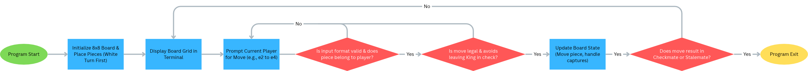

# Terminal Based Chess Playing Program

A two-player terminal chess game built in Java to provide a lightweight, local strategy game experience that runs instantly in any command-line environment.

## The Problem

As a computer science student, I enjoy playing strategy games like chess with friends between classes, but many online platforms require accounts, heavy web browsers, or constant internet connections. I care about solving this because I want to build a lightweight, local terminal-based chess game that runs instantly in any command-line environment and helps me deepen my understanding of object-oriented inheritance, complex move validation, and 2D board state management in Java.

## How It Works

This application is a command-line interface (CLI) program that enables two players to play a head-to-head game of chess directly within the terminal. The application maintains an 8x8 grid board object, alternates turns between White and Black, parses player coordinate inputs, validates piece movement rules and checks, and handles game-ending checkmate or stalemate conditions.



## Tech Stack

- **Language:** Java (JDK 17+)
- **Libraries:** `java.util.Scanner`, `java.util.ArrayList`
- **External tools:** Standard terminal command line / command prompt

## Setup

```bash
git clone [https://github.com/Arkapravo-Sen/Arkapravo-Sen-CS-193-Week-9.git](https://github.com/Arkapravo-Sen/Arkapravo-Sen-CS-193-Week-9.git)
cd Arkapravo-Sen-CS-193-Week-9
javac src/Main.java
java src.Main
```

## Usage

# Compile the java files from the source directory
javac src/*.java

# Run the game entry point
java src.Main

# Follow the terminal prompts to input your chess moves (e.g., e2 to e4)

## Roadmap

[ ] Advanced rules: Castling, En Passant, and Pawn Promotion
[ ] Single-player mode against a basic AI opponent
[ ] Save/Load game state using a local text file

## Author

Arkapravo Sen, https://github.com/Arkapravo-Sen